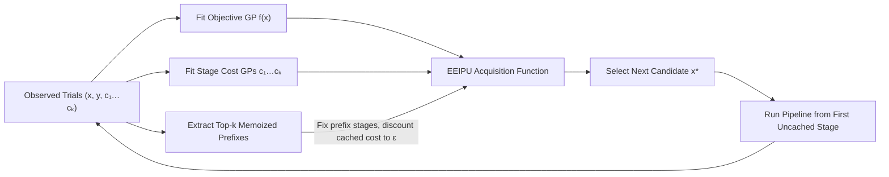

# EEIPU: Memoization- and Cost-Aware Bayesian Optimization

[](LICENSE)
[](https://arxiv.org/abs/2411.03731)

**EEIPU** (*Expected Expected Improvement Per Unit Cost*) is a memoization- and cost-aware Bayesian Optimization library for tuning multi-stage machine learning, computer vision, and language model training pipelines, accompanying the paper [*Reducing Hyperparameter Tuning Costs in ML, Vision and Language Model Training Pipelines via Memoization-Awareness*](https://arxiv.org/abs/2411.03731).

## Problem Statement

Modern machine learning, computer vision, and language-model workflows are structured as multi-stage pipelines (e.g., data preparation, feature extraction, model training, and evaluation), where tuning hyperparameters across all stages is expensive in GPU-days. Conventional Bayesian Optimization treats each pipeline evaluation as a monolithic black box and restarts every trial from scratch, ignoring both stage-wise cost variation and the fact that trials sharing early-stage hyperparameters can reuse cached intermediate outputs. EEIPU models per-stage evaluation costs with Gaussian Processes and optimizes over a pool of memoized prefixes, steering the search toward high-value candidates that skip redundant upstream computation.

## Method Overview



## Paper Benchmark Summary

Across real-world multi-stage ML, vision, and language model fine-tuning pipelines reported in [arXiv:2411.03731](https://arxiv.org/abs/2411.03731), EEIPU demonstrated:

| Metric (Real-World Pipelines) | Improvement over Baselines |
|---|---|
| Evaluated hyperparameter candidates (same compute budget) | **+103%** on average |
| Objective improvement after warm-up | **+108%** on average |

*Figures above are taken directly from [arXiv:2411.03731](https://arxiv.org/abs/2411.03731).*

## Quick Start

### Installation

```bash
pip install eeipu
```

Or install from source in editable mode:

```bash
git clone https://github.com/ridwan-salau/cost-aware-bo.git
cd cost-aware-bo
pip install -e .
```

Optional Weights & Biases logging support:

```bash
pip install "eeipu[wandb]"
```

### Minimal Example

```python
from eeipu import EEIPUOptimizer

# Keys follow "<stage_index>__<param_name>"
search_space = {
    "0__chunk_size": {"lower": 128, "upper": 512, "dtype": "int"},
    "1__lr": {"lower": 1e-4, "upper": 1e-2, "dtype": "float"},
    "1__epochs": {"lower": 1, "upper": 5, "dtype": "int"},
}

optimizer = EEIPUOptimizer(
    search_space=search_space,
    n_init=5,
    total_budget=100.0,
    acq_type="EEIPU",
    seed=42,
)

for _ in range(10):
    hps = optimizer.suggest()

    # Run your multi-stage pipeline with caching for stage 0
    # and measure validation metric + per-stage compute costs:
    stage0_cost = 2.0
    stage1_cost = 1.0 + 0.5 * hps["1__epochs"]
    objective = -(hps["1__lr"] - 1e-3) ** 2 - 1e-6 * (hps["0__chunk_size"] - 256) ** 2

    optimizer.observe(hps, objective=objective, stage_costs=[stage0_cost, stage1_cost])

best_hps, best_obj = optimizer.best()
print("Best hyperparameters:", best_hps, "Best objective:", best_obj)
```

Both `import eeipu` and `from cost_aware_bo import generate_hps, update_dataset_new_run, log_metrics` are supported for backwards compatibility with the paper's experiment scripts (`stacking/`, `segmentation/`, `t5_fine_tuning/`).

## Using EEIPU on Constrained or On-Premises Hardware

EEIPU is designed to run locally without external cloud services or telemetry:

- **Offline by default:** Core optimization runs entirely in-process on CPU or local GPU using PyTorch and BoTorch, with no required network calls or Weights & Biases account (`wandb` is optional).
- **Prefix reuse under fixed compute budgets:** By tracking per-stage costs and prioritizing candidates that reuse cached upstream stages, EEIPU is intended for environments where data cannot leave local hardware (such as on-premises clusters or isolated enclaves) and GPU/CPU hours are tightly constrained.

## Contributors & Acknowledgments

### Code Contributors

- **Ridwan Salahuddeen** (`ridzy619@yahoo.com`)
- **Abdelmajid Essofi** (`abdelmajid.essofi@mbzuai.ac.ae`, `@mekhiito`)

### Paper Authors ([arXiv:2411.03731](https://arxiv.org/abs/2411.03731))

Abdelmajid Essofi, Ridwan Salahuddeen, Munachiso Nwadike, Elnura Zhalieva, Kun Zhang, Eric P. Xing, Willie Neiswanger, and Qirong Ho.

See [AUTHORS.md](AUTHORS.md) and [CITATION.cff](CITATION.cff) for full attribution.

## Citation

If you use this software in your research, please cite:

```bibtex
@article{essofi2024reducing,
  title={Reducing Hyperparameter Tuning Costs in ML, Vision and Language Model Training Pipelines via Memoization-Awareness},
  author={Essofi, Abdelmajid and Salahuddeen, Ridwan and Nwadike, Munachiso and Zhalieva, Elnura and Zhang, Kun and Xing, Eric P. and Neiswanger, Willie and Ho, Qirong},
  journal={arXiv preprint arXiv:2411.03731},
  year={2024}
}
```

## License

Licensed under the [Apache License, Version 2.0](LICENSE).
